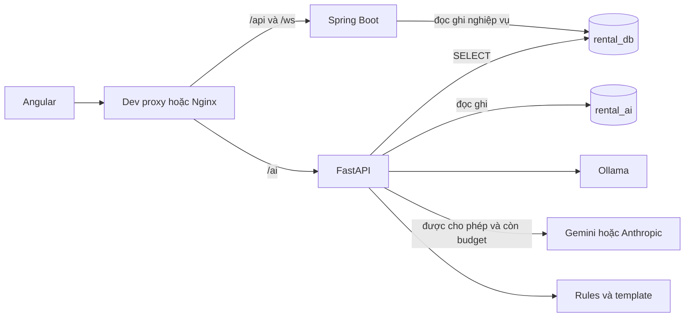
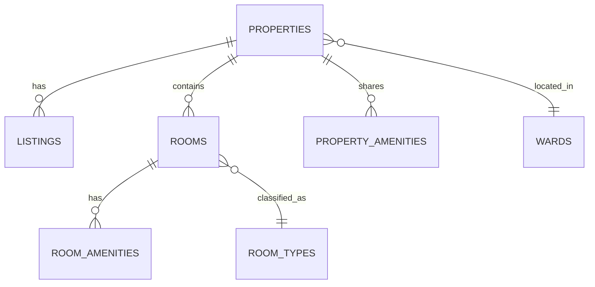
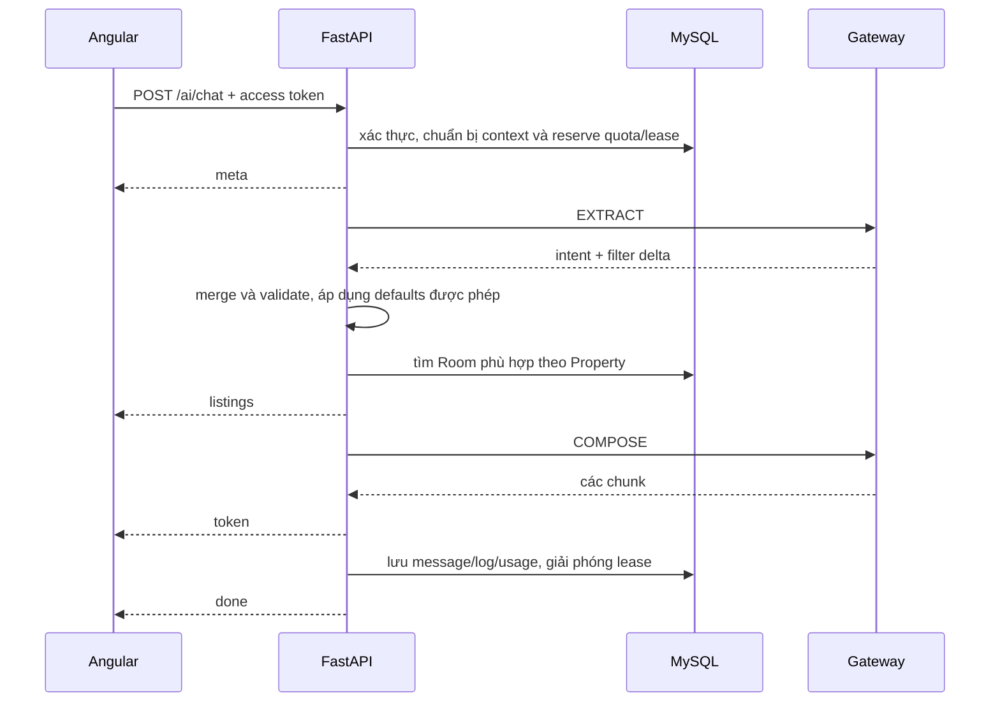

# AI Service — thiết kế và hướng dẫn tích hợp

Cập nhật: **30/10/2026**, sau đợt sửa code tích hợp `AIService`, `RentalManagement`, `DOANTOTNGHIEPFE`.

## 1. Trạng thái hiện tại

Đã sửa phần tích hợp chính trong source và bổ sung kiểm thử hồi quy. Chưa áp dụng thay đổi vào MySQL đang sử dụng, chưa gọi Ollama/provider ngoài, chưa triển khai container. **Cần thực hiện migration và cấp quyền DB ở mục 10 trước khi chạy bản code mới với dữ liệu thật.**

| Hạng mục | Đã thực hiện |
| --- | --- |
| Schema | Chuyển ORM/query AI sang `Listing → Property → Rooms`, bỏ tham chiếu các cột cũ |
| Truy vấn | Dùng chung inventory cho chat, recommendation, embedding; loại tin hết hạn và tin cũ của cùng Property |
| Tiện ích | Kết hợp tiện ích Property với tiện ích của đúng Room; điều kiện bắt buộc chạy trong SQL trước LIMIT |
| Kết quả | Một Listing/card với một Room đại diện thật, có `property_id`, `matched_room_id`, `rental_mode` |
| Chat | Request-local Gateway/provider/logger; DB session ngắn được tạo/dùng/đóng trong cùng tác vụ đồng bộ |
| Bộ lọc | Validate sau merge/defaults; thêm tiện ích không làm mất tiện ích cũ; hỏi lại địa điểm/tiện ích không phân giải được |
| Rules | Handler truyền catalogue của request vào Rules, giống dữ liệu dùng để đối chiếu tên |
| Quota | Reserve lượt trước khi gọi model; lease DB giới hạn đồng thời; reserve external theo lần gọi, fail closed |
| Log/usage | Ghi provider/latency/fallback/message ID; tổng hợp usage từ records trước khi flush; xử lý cả lỗi/ngắt stream |
| Privacy | Sanitize extract/compose external, sửa regex CCCD 12 chữ số, Gemini key đi qua header |
| Ownership | Feedback kiểm tra conversation owner; event kiểm tra owner, listing/position/source và chống trùng bằng ID xác định |
| Embedding | Snapshot RAM bất biến, validate payload, reload định kỳ từ DB mỗi worker |
| Retention | Bỏ truy cập `AiMessage.user_id`; không xóa conversation chỉ vì một message cũ; dry-run rollback |
| FE | Sửa environment development, gắn recommendation thật và chatbot vào giao diện tenant |
| Streaming FE | Refresh một lần khi HTTP 401 trước stream; hỗ trợ CRLF/chunk; báo EOF thiếu done; hủy request khi dừng |
| Local Docker | Có Nginx local riêng, host gateway, mẫu env AI container; giữ cấu hình TLS production riêng |
| Evaluation | Loại held-out listing và tương tác tương lai khỏi vector train; dùng chung hàm ranking production |

BE Java và Flyway hiện tại không bị sửa trong đợt này. AI thích nghi với schema nguồn BE; không sửa migration core đã tồn tại để ép khớp mô hình cũ.

## 2. Kiến trúc và trách nhiệm



Spring sở hữu đăng nhập/refresh, user/role, Property/Room/Listing, hồ sơ và thao tác nghiệp vụ. FastAPI sở hữu bộ lọc/tìm kiếm AI, ranking, câu trả lời, log, quota và embedding. FE gọi AI trực tiếp qua proxy `/ai`; không cần Spring controller chuyển tiếp chat.

AI không ghi core và không sinh SQL từ output LLM. `POST /ai/events` là telemetry: event SAVE/CONTACT không thay cho API nghiệp vụ Spring thực hiện hành động đó.

Hai engine SQLAlchemy tách schema; quyền SELECT do MySQL thực thi mới là ranh giới read-only. Không dùng credential admin làm credential runtime.

## 3. Hợp đồng Property/Room

Nguồn chuẩn: BE `Listing.java`, `Property.java`, `Room.java`, `ListingRepository.PUBLIC_CONDITION` và `V1__fullsql.sql`.



`listings.property_id` và `rooms.property_id` cùng tham chiếu Property. Chủ nhà, tỉnh/phường, địa chỉ, tọa độ nằm ở `properties`. Giá, diện tích, số người, loại phòng và tình trạng cho thuê nằm ở `rooms`. `properties.rental_mode` là WHOLE hoặc BY_ROOM.

`app/db/inventory.py` là lớp query dùng chung:

1. Listing PUBLISHED, `expires_at > now()`.
2. Loại Listing nếu cùng Property có tin PUBLISHED còn hiệu lực mới hơn theo published_at, rồi ID — theo quy tắc BE.
3. Join Property và Room AVAILABLE.
4. Lọc địa điểm theo Property; giá/diện tích/loại phòng/sức chứa theo cùng một Room.
5. Mỗi tiện ích cần có trong tiện ích riêng Room hoặc tiện ích chung Property.

Chat chọn Room rẻ nhất đáp ứng tất cả điều kiện cho mỗi Listing, có tie-break Room ID, bằng `row_number` sau lọc. Recommendation chấm điểm từng Room, giữ Room tốt nhất cho mỗi Listing rồi MMR. Không ghép giá phòng A với diện tích/tiện ích phòng B.

Ví dụ: A giá 2 triệu, 12 m²; B giá 4 triệu, 30 m². Yêu cầu dưới 3 triệu, từ 25 m² không khớp nếu không có Room thứ ba đáp ứng cả hai.

Với WHOLE, vẫn dùng Room mà BE quản lý cho đơn vị thuê nguyên căn; không tự cộng các Room thành một sản phẩm mới. Fixture seed BE hiện có room_number WHOLE.

Card mới vẫn giữ các khóa cũ để FE tương thích:

```json
{
  "id": "listing-uuid",
  "listing_id": "listing-uuid",
  "property_id": "property-uuid",
  "matched_room_id": "room-uuid",
  "rental_mode": "BY_ROOM",
  "title": "Phòng gần trường",
  "price": 2800000,
  "area_m2": 26,
  "ward_name": "Tên phường",
  "address_line": "Địa chỉ công khai",
  "room_type_name": "Phòng đơn",
  "amenities": ["Wifi", "Điều hòa"]
}
```

Chat dùng `id` cùng `listing_id`; recommendation dùng `listing_id`. FE recommendation chuyển về model card dùng `id`. Card AI chưa lấy ảnh nên UI hiển thị nội dung thật, không thay bằng ảnh/dữ liệu mock.

## 4. Chat và SSE



`app/api/chat.py` là pipeline SSE duy nhất; đã bỏ bản `run_chat()` không được gọi để tránh hai logic persist khác nhau. Các helper trong `app/chat/service.py` vẫn dùng chung.

Mỗi pha DB đồng bộ được chạy qua worker với session tạo/đóng trong chính pha đó. Không giữ transaction core mở trong lúc chờ LLM, không đưa một Session từ event loop qua nhiều lần `to_thread`.

| Event | Ý nghĩa |
| --- | --- |
| meta | request_id nội bộ và conversation_id |
| listings | Card của các Room thực sự đáp ứng điều kiện |
| token | Chunk câu trả lời để nối vào UI |
| retry | Provider hỏng sau khi đã phát nội dung; dừng câu trả lời, cho thử lại thủ công |
| done | OK / CLARIFY / OUT_OF_SCOPE / FAILED cùng message_id nếu lưu được |

Nếu lỗi xảy ra trước token đầu, gateway thử provider tiếp theo. Nếu lỗi sau token đầu, không nối câu của model khác vào nội dung dở dang. Tổng thời gian xử lý có giới hạn `CHAT_TIMEOUT_SECONDS`; client hủy thì tác vụ được đóng và log/usage được chốt. Chưa có heartbeat SSE.

`conversation_id` không tồn tại/không thuộc user trả 404. ID nội bộ sinh UUID; header correlation bên ngoài không điều khiển ID ghi DB.

### Bộ lọc và defaults

LLM trả schema có intent SEARCH/FOLLOW_UP/CLARIFY/OUT_OF_SCOPE và các điều kiện. SQL do code dựng với bind parameters. Sau khi gộp lượt trước/lượt mới, Pydantic validate lại toàn bộ khoảng giá/diện tích.

Tiện ích được thêm cộng dồn. Chưa có thao tác clear/remove riêng trong schema: “bỏ điều hòa”, “bỏ giới hạn giá” chưa được bảo đảm; có thể mở hội thoại mới để bỏ toàn bộ điều kiện.

Giá chat được lọc nghiêm, không tự tăng 20% cho yêu cầu “dưới 3 triệu”. Địa điểm không phân giải được hoặc trùng ở nhiều tỉnh phải hỏi lại; không âm thầm bỏ lọc địa điểm. Tỉnh được phân giải riêng khi LLM trả trường province.

Profile defaults chỉ được dùng khi cho phép cá nhân hóa. `filters_json` của message mới lưu điều kiện hội thoại trước khi áp dụng profile defaults, để lượt sau áp dụng lại hồ sơ hiện tại. Hội thoại lưu từ bản cũ có thể chưa phân biệt nguồn mặc định; nên tạo hội thoại mới khi chuyển phiên bản.

Rules nhận catalogue phường/tỉnh/tiện ích của request. Chat hiện tìm bằng SQL, chưa có vector retrieval cho chatbot.

## 5. Recommendation và embedding

```text
score = 0.50 × profile + 0.35 × behavior + 0.10 × freshness + 0.05 × boost
profile: price 0.30, location 0.25, amenities 0.20, area 0.15, room_type 0.10
```

Ưu tiên người dùng chọn được nhân 1,5 và chuẩn hóa lại. Không có vector hành vi thì dùng profile=0,85, behavior=0, freshness=0,10, boost=0,05. MMR lambda=0,7 áp dụng sau khi gộp về một Listing.

Vector hành vi lấy embedding của tin đã VIEW/SAVE/CONTACT từ ba bảng core, trọng số 1/3/5, suy giảm `exp(-days/14)`, rồi chuẩn hóa. Telemetry `recommendation_events` chưa tự trở thành nguồn hành vi ranking.

Tiện ích bắt buộc lọc trên đúng Room, gồm tiện ích Property. `price_tolerance_pct=0` được giữ nguyên. `allow_personalization=false` làm recommendation bỏ hồ sơ/hành vi cá nhân, chat không lấy profile defaults; điều kiện người dùng nhập trong hội thoại vẫn có hiệu lực.

Embedding dùng multilingual E5, mặc định 384 chiều, CPU, prefix passage và normalize. Văn bản tin được tổng hợp từ các Room đang có thể thuê của Listing hiện tại. Vector lưu BLOB float32 trong schema AI. Sync chỉ embed lại text có content hash đổi và dọn tin không còn đủ điều kiện công khai.

Store RAM dùng snapshot bất biến: validate dimension/payload/finite values trước khi đổi snapshot. Mỗi worker reload từ DB mỗi `EMBEDDING_RELOAD_SECONDS` (mặc định 60); lỗi reload giữ snapshot cũ. Script build trong process riêng vì vậy được worker nhận sau lần reload tiếp theo. **Chưa có scheduler tự chạy build embeddings**; cần job vận hành gọi script theo lịch.

Một số giới hạn còn giữ: tối đa 500 Room ứng viên trước scoring; thiếu tọa độ làm điều kiện khoảng cách không thực thi cho Room đó; quá sức chứa hiện bị giảm điểm trong recommendation, còn chat lọc cứng. `tenant_type`, note, move_in_date chưa tham gia công thức. Boost vẫn dùng priority_level lưu trên Listing, chưa đồng bộ toàn bộ logic gói/boost hiệu lực của BE.

## 6. Xác thực, ownership và dữ liệu ngoài hệ thống

BE và AI dùng HS512, cùng secret UTF-8, issuer rental-management. Không tự base64-decode secret chỉ vì chuỗi có hình dạng base64. Claims: sub, exp, type=access, authVersion, scope chứa ROLE_TENANT.

AI kiểm tra user ACTIVE/auth_version qua cache mặc định 30 giây. Thay đổi status/version có cửa sổ cache tương ứng; đổi role cần chính sách thu hồi token. Secret hai `.env` đã được so khớp trong lần rà soát trước; chưa kiểm tra token đăng nhập BE thực tế trong đợt sửa này.

- Feedback join message với conversation của current user; biết message ID người khác không đủ quyền đánh giá.
- Event recommendation phải thuộc request của user, source khớp, listing có trong snapshot kết quả; position được server xác định.
- Event chatbot phải thuộc assistant message trong conversation của user và có listing trong kết quả.
- Event lặp cùng user/request/listing/type dùng cùng ID, tránh đếm trùng khi client gửi lại.

External EXTRACT và COMPOSE cùng sanitize văn bản user/filter/listing payload. Regex chỉ giảm rủi ro PII; không bảo đảm mọi tên/địa chỉ nhạy cảm đều được loại. Không gửi hồ sơ nguyên bản, note, anchor hoặc thông tin liên hệ private vào prompt.

Gemini key gửi bằng `x-goog-api-key`, không gắn vào query URL dễ lọt HTTP log. Error detail từ gateway chỉ lưu tên loại lỗi để tránh ghi raw prompt/key. Provider request-local tránh `last_usage` lẫn giữa user; usage compose được đọc từ stream provider khi có.

CORS mặc định localhost:4200 và localhost; production cấu hình `CORS_ORIGINS` theo origin thực tế. HTTP cùng origin qua proxy vẫn là topology ưu tiên.

## 7. Quota, concurrency và log

| Dữ liệu/trạng thái | Phạm vi |
| --- | --- |
| Gateway, providers, records, last_usage | Một request |
| Breaker | Chia sẻ theo provider trong một process; chưa có backend breaker dùng chung các replica |
| Chat quota/ngày | `ai_usage_daily`, update có điều kiện trong transaction |
| Chat đang chạy | `ai_chat_leases`, serialize qua `ai_user_locks` độc lập ranh giới ngày; TTL tránh giữ slot vĩnh viễn khi worker chết |
| External budget/ngày | Hàng đặc biệt user_id=`__external_budget__`, reserve nguyên tử trước từng provider call |

Một lượt chat được chấp nhận tính vào quota kể cả câu hỏi cần làm rõ, thất bại hoặc user ngắt stream. Request bị chặn bởi concurrency rollback và không tiêu quota. Lease được giải phóng khi kết thúc/ngắt, với TTL bằng deadline + 30 giây.

Đếm local/external usage từ records của đúng request, trước khi flush. Các record BREAKER_OPEN/CAP_EXCEEDED không tính là provider call đã thực hiện. Budget external không xác minh được do DB lỗi thì bỏ external và đi tầng tiếp theo. Quota ngày theo `QUOTA_TIMEZONE` mặc định Asia/Ho_Chi_Minh.

Hàng `__external_budget__` là bộ đếm tổng riêng; dashboard cộng usage theo user phải loại hàng này để tránh cộng hai lần. Token/cost chỉ là phần provider trả được; bị ngắt trước usage cuối có thể thiếu. Local tự sửa JSON trong cùng extract có thể gọi model hai lần nhưng hiện log theo gateway attempt. Bảng giá trong usage.py là ước tính viết cứng, chưa xác nhận giá hiện hành nhà cung cấp.

`GET /ai/health` trả 503 khi DB/query schema cần thiết không sẵn sàng, gồm bảng lease và cột snapshot mới. Thông tin LLM trong health là cấu hình, không phải probe model. Access log middleware chưa đo toàn bộ thời gian SSE; dùng latency assistant message cho thời gian hoàn tất lượt.

## 8. Schema AI và retention

Alembic mới: **20261030_ai_integration**, nối sau **3f74f84bdcff**:

- Thêm `recommendation_requests.listing_ids` JSON để kiểm chứng event.
- Tạo `ai_chat_leases(request_id, user_id, expires_at)` và index user/expiry.
- Tạo `ai_user_locks(user_id)` để giữ giới hạn đồng thời đúng qua thời điểm đổi ngày.

Các bảng chính vẫn gồm conversations/messages, llm_call_logs, listing_embeddings, recommendation_requests/events, feedback, usage_daily, sync/eval_runs. `user_recommendations` và `sync_state` chưa có luồng runtime dùng chính thức.

Retention script dọn messages/call logs sau 90 ngày, telemetry sau 365 ngày. Feedback tối đa 365 ngày nhưng có thể bị cascade sớm hơn khi message cha hết hạn. Conversation chỉ dọn khi rỗng và đủ cũ; không xóa message mới vì cùng conversation với message cũ.

User không còn ở core được xác định qua các model có user_id, gồm conversation; xóa conversation cascade messages/feedback. `--dry-run` rollback transaction. Đã kiểm thử bằng DB tạm, **chưa chạy purge trên DB người dùng**.

## 9. Giao diện FE

Landing hiển thị gợi ý từ API cho tài khoản có ROLE_TENANT, có trạng thái loading/empty/error và nút làm mới. Card đi đến `/tro/:listingId`, gửi impression/click theo request ID. Không hiển thị phần AI cho người không có quyền.

Tenant layout có nút Trợ lý tìm phòng riêng với Chat hỗ trợ quản trị viên. Chatbot nhận token từng phần, card, lỗi, retry thủ công, dừng, hội thoại mới và đánh giá. Nội dung được render bằng interpolation, không chèn HTML từ model.

HttpClient đi qua auth interceptor. Fetch chat tự đính Bearer và chỉ refresh/retry một lần khi HTTP 401 trước stream; AuthService chia sẻ refresh đang chạy để tránh nhiều lần xoay refresh token. Không tự gửi lại sau khi đã nhận nội dung vì có thể tạo lượt/chi phí trùng.

Environment development có aiUrl=/ai. Production-docker dùng environment.docker.ts theo angular.json; environment.production-docker.ts chưa được cấu hình đó tham chiếu.

## 10. Cách áp dụng vào môi trường thật

### Local development trên host

BE compose hiện chỉ chạy hạ tầng. Giữ Spring tại host:8080, AI tại host:8000, Angular tại host:4200; dev proxy đã chuyển `/api`, `/ai`, `/ws` đúng cổng.

1. Chạy BE để xác nhận Flyway/schema hiện tại. Không drop/reset DB.
2. Dùng tài khoản quản trị DB thực hiện phần cấp quyền AI đã cập nhật trong `scripts/setup_database.sql`. Với user/schema đã có, thay đổi mới tối thiểu là:

```sql
GRANT SELECT ON rental_db.properties TO 'ai_svc'@'%';
GRANT SELECT ON rental_db.property_amenities TO 'ai_svc'@'%';
```

Không cấp quyền ghi core cho runtime. Kiểm tra `SHOW GRANTS` trên tài khoản đích. Script đầy đủ có placeholder password cho lần tạo user mới; không dùng nguyên placeholder cho deployment thật.

3. Tại AIService, dùng venv có dependencies cập nhật; requirements mới có tzdata để múi giờ hoạt động trên Windows. `.env` phải có DB URLs/secret thật khớp BE.

```powershell
# cwd: E:\SpringBoot\DoAn\AIService
.\.venv\Scripts\python.exe -m pip install -r requirements.txt
.\.venv\Scripts\python.exe -m alembic upgrade head
.\.venv\Scripts\python.exe -m scripts.build_embeddings
.\.venv\Scripts\python.exe -m uvicorn app.main:app --host 127.0.0.1 --port 8000
```

4. Chạy FE bằng Node phiên bản thỏa engines của Angular CLI đã cài, rồi `npm start`.
5. Đăng nhập tenant qua BE thật; kiểm tra `/ai/health`, `/ai/me`, recommendation và chat trên trình duyệt. Database phải có Listing được publish và Room AVAILABLE; seed BE hiện không tự tạo Listing công khai.

Build embedding có thể tải model khi chưa cache. `build_embeddings` chưa được chạy trên DB hiện có trong đợt sửa. Các script seed/token/smoke yêu cầu `SEED_DB_URL` tường minh thay vì tự dùng root credential viết cứng. Không dùng script seed để thay thế kiểm thử token từ BE thật.

### Local Docker

FE compose mount `nginx.local.conf` phục vụ HTTP port 80, chuyển BE/AI qua host.docker.internal. Có thể chạy Spring/AI trên host hoặc AI container publish 8000; process host phải bind địa chỉ mà container truy cập được, ví dụ AI `--host 0.0.0.0` nếu dùng FE Docker. Đây là cấu hình local; không public cổng backend/AI tùy tiện lên Internet.

AI compose có host gateway và hỗ trợ chọn env file. Copy `.env.docker.example` thành `.env.docker`, điền credential thật và JWT secret; hai DB URLs phải trỏ host.docker.internal:3306 khi MySQL là container BE publish lên host. Trong Docker, localhost không phải máy host.

```powershell
# cwd: AIService; .env.docker đã được điền đúng
$env:AI_ENV_FILE = '.env.docker'
docker compose build ai-service
docker compose run --rm --no-deps ai-service python -m alembic upgrade head
docker compose up -d ollama
docker compose exec ollama ollama pull qwen3:4b
docker compose run --rm --no-deps ai-service python -m scripts.build_embeddings
docker compose up -d ai-service
```

MySQL/grants core phải sẵn sàng trước những lệnh migration/build trên. Migration là bước release riêng, không tự chạy trong mỗi replica.

FE `nginx.conf` TLS production vẫn riêng với local: production cần certificate mounts, publish 443 và backend/ai-service DNS trên mạng chung. Các compose hiện chưa phải một bộ triển khai production tổng. Không dùng compose local như cấu hình TLS đã sẵn sàng.

AI Dockerfile cài torch CPU trước sentence-transformers để tránh kéo bản GPU không cần thiết.

### Các biến mới

```dotenv
CHAT_TIMEOUT_SECONDS=120
QUOTA_TIMEZONE=Asia/Ho_Chi_Minh
EMBEDDING_RELOAD_SECONDS=60
CORS_ORIGINS=["http://localhost:4200","http://localhost"]
```

Default vẫn có chat quota 30/ngày và 3 request đồng thời/user; external chỉ dùng khi được bật và còn budget. Tắt ALLOW_EXTERNAL_FALLBACK khi chưa muốn gọi API trả phí.

## 11. Kiểm chứng đã hoàn tất

| Kiểm tra | Kết quả |
| --- | --- |
| Pytest AI | 15 tests đạt: schema/Property/Room, query, HTTP SSE, quota/usage/ownership, retention, snapshot, holdout |
| Concurrency quota | Các connection độc lập giữ đúng 3 slot; request bị từ chối không tiêu quota; tổng accepted đúng trần ngày |
| Kiểm thử FE | 18 files, 78 tests đạt; thay test title boilerplate cũ bằng kiểm tra root hiển thị routed page |
| FE development build | Đạt |
| FE production-docker build | Đạt, với quyền tải Google Fonts lúc build |
| Python lint E9/F | Đạt |
| Alembic MySQL DDL offline | Sinh được migration mới; một head 20261030_ai_integration |
| Compose config | Hai compose parse thành công bằng config --quiet |

Các test DB dùng SQLite tạm; có test đối chiếu mapping với DDL BE và biên dịch migration MySQL offline. **Chưa thay thế kiểm thử transaction/collation/thời gian trên MySQL thật.** Chưa kiểm tra runtime Docker, model local/external, token đăng nhập thật hoặc luồng trình duyệt với cả ba service đang chạy.

Test FE còn cảnh báo cấu hình polyfills hiện có; production build cảnh báo CommonJS của STOMP. Không chặn các bước kiểm tra trên.

## 12. Những việc còn lại trước production

- Hoàn thiện BE API/UI hồ sơ nhu cầu tenant và ghi hành vi xem/lưu/liên hệ; hiện mới có bảng/entity tương ứng, không mặc định coi recommendation đã có dữ liệu thật.
- Đồng bộ priority hiệu lực giữa AI và logic gói/boost BE; xem lại điều kiện khoảng cách khi thiếu tọa độ và lựa chọn lọc cứng sức chứa trong recommendation.
- Bổ sung thao tác clear/remove bộ lọc, cải thiện alias/phân cấp loại phòng và tên địa điểm.
- Scheduler build embedding, cơ chế khóa job sync nếu có nhiều scheduler, khóa dependency versions và quan sát nhiều worker.
- Breaker dùng chung replica/half-open probe chặt hơn, heartbeat SSE và kiểm thử tải trên MySQL cùng model thực tế.
- Chốt triển khai TLS/network/secrets production, tài khoản runtime AI riêng tài khoản migration, retention/consent và metric chi phí.

Offline evaluation hiện loại target khỏi train nhưng dùng profile/catalogue hiện tại, chưa phải historical replay. Dữ liệu giả và bộ Rules mẫu không chứng minh chất lượng người dùng thật. Cần baseline, dữ liệu có thời điểm và đánh giá latency/Recall/NDCG/coverage trước khi quyết định đổi model hoặc thêm vector retrieval cho chatbot.

## 13. Bản đồ source và tài liệu đối chiếu

| File/module | Trách nhiệm |
| --- | --- |
| `app/db/models_core.py`, `inventory.py` | Model core hiện tại và query Property/Room dùng chung |
| `app/api/chat.py`, `app/chat/service.py`, `search.py` | Pipeline SSE, context/bộ lọc và tìm kiếm |
| `app/chat/llm/` | Provider, fallback, breaker, usage |
| `app/core/rate_limit.py` | Reservation quota và lease DB |
| `app/api/events.py` | Feedback/event ownership và attribution |
| `app/recommend/service.py`, `scoring.py`, `candidates.py` | Candidate Room, ranking, gộp Listing, MMR |
| `app/embeddings/` | Model, sync và snapshot RAM/reload |
| `alembic/versions/20261030_property_integration.py` | Migration AI mới |
| `scripts/setup_database.sql`, `purge_logs.py`, `evaluate_recsys.py` | Quyền DB, retention và evaluation |
| FE `core/services/ai.service.ts`, `auth.service.ts` | JSON/SSE client và refresh phối hợp |
| FE `shared/components/ai-chat/`, `ai-listing-cards/` | Chatbot và card AI thật |
| FE `features/landing/components/ai-recommendation/` | Recommendation landing |
| FE `nginx.local.conf`, `nginx.conf`, compose/environment | Routing local/production và build |

Đã đối chiếu API bằng Context7 với [SQLAlchemy ORM queries](https://docs.sqlalchemy.org/en/20/orm/queryguide/select.html), [Angular effect cleanup](https://github.com/angular/angular/blob/main/packages/core/src/render3/reactivity/effect.ts) và [Gemini REST authentication](https://ai.google.dev/api). Token/model/key/giá thực tế vẫn cần kiểm chứng trong tài khoản deployment.
